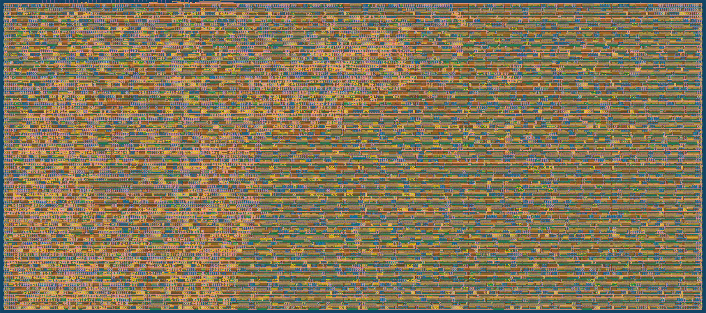
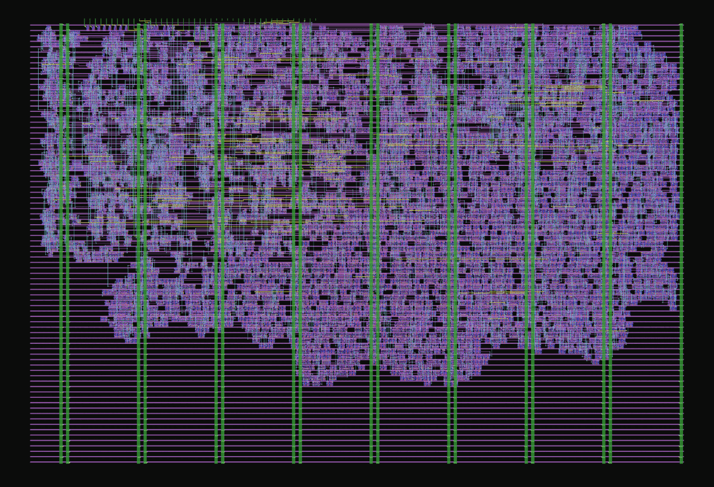
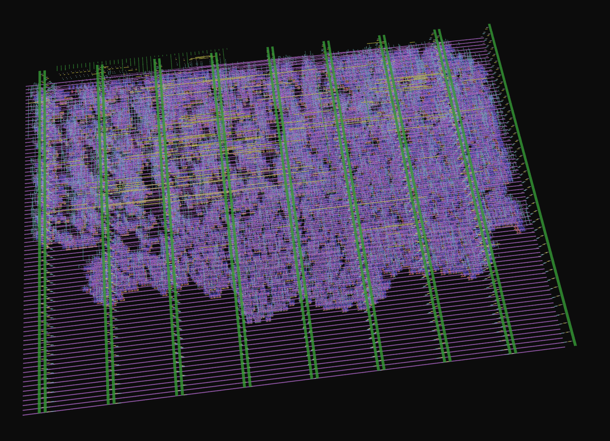
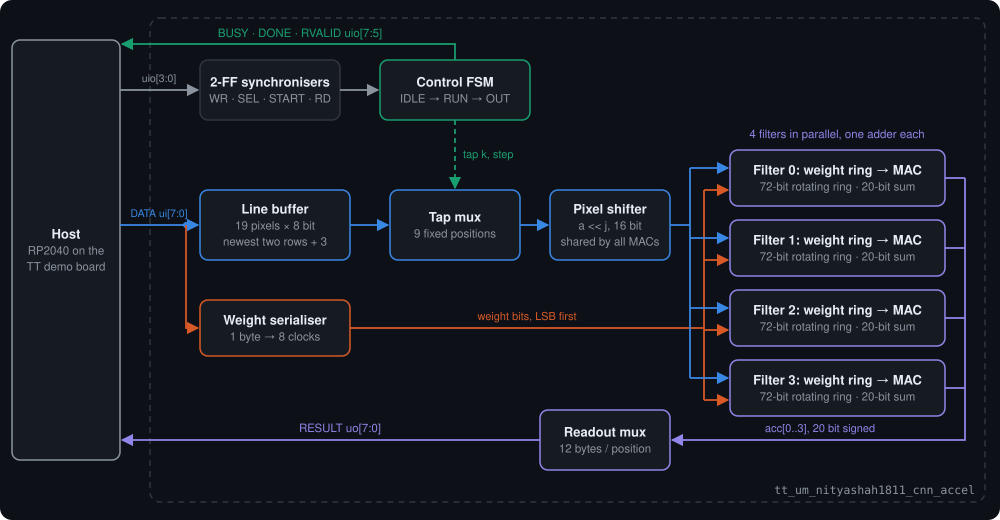
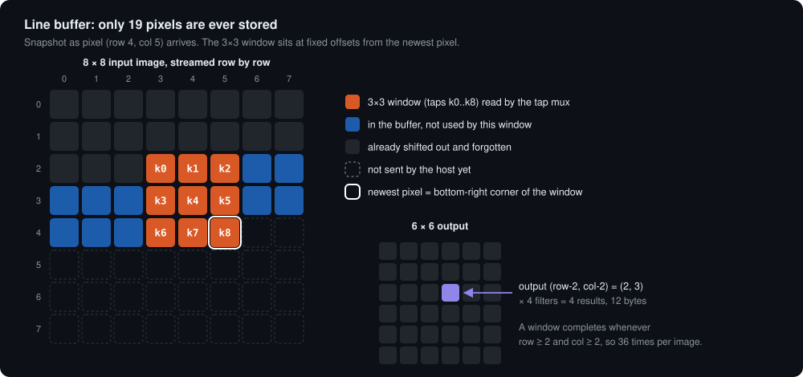
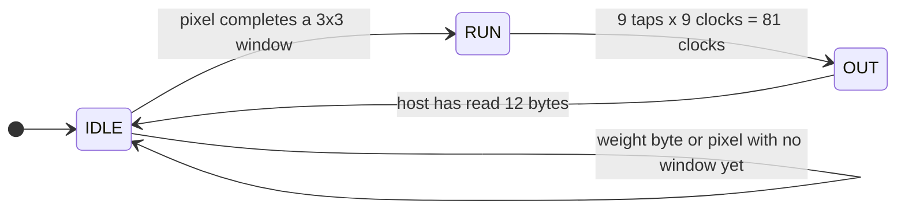
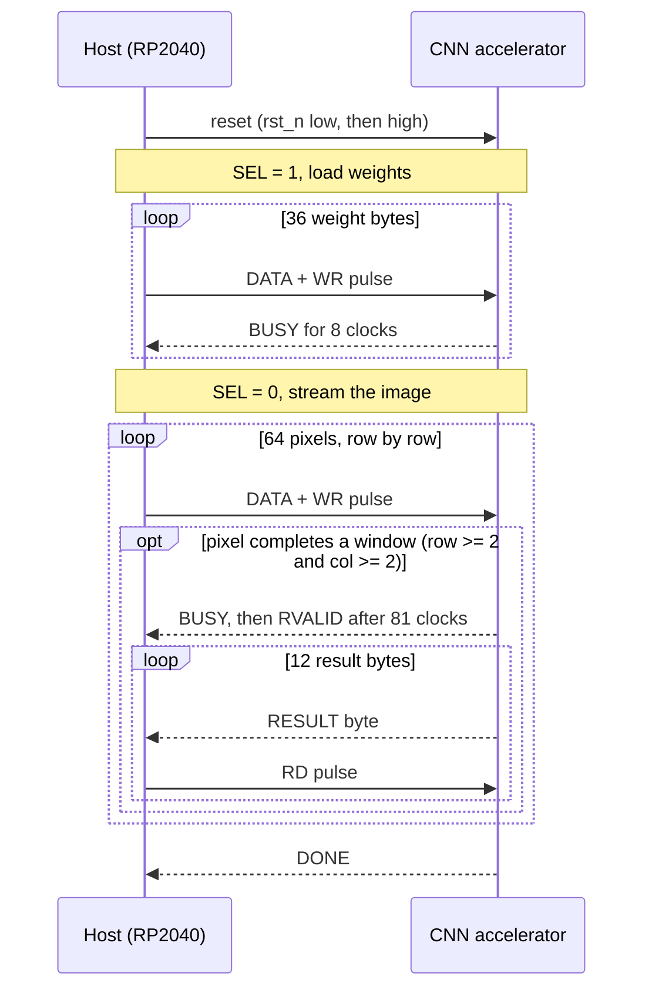
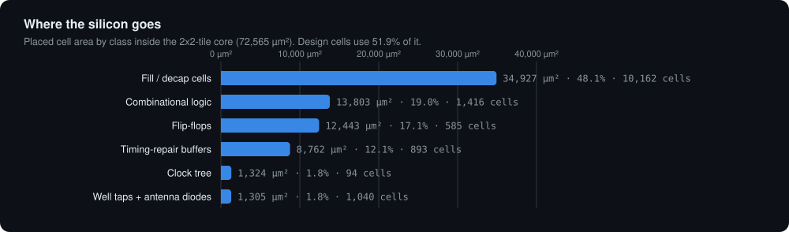
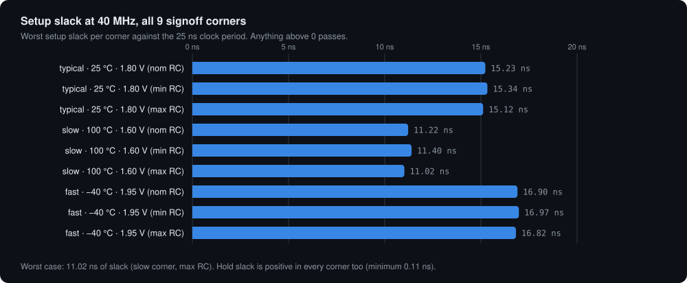

   

# CNN Conv Accelerator

## Overview

A 3x3 convolution accelerator for [Tiny Tapeout](https://tinytapeout.com)
(sky130): 8x8 INT8 image, 4 filters in parallel, 6x6x4 INT20 output.

**Team:** Nitya Shah, Kush Shah, Kiran Karthik, Toprak Celikel

Built in the Basics of ASICs course at the
[MIT Beaver Works Summer Institute](https://bwsi.mit.edu/bwsi-programs-2/basics-of-asics/).


**MITRE - Proud Sponsor of MIT BWSI bASICs of ASICs**



| | |
|---|---|
| Size | 2x2 tiles |
| Clock | 40 MHz |
| Checks | precheck, DRC, LVS, timing and gate-level tests all pass |

How it works and how to use it: [docs/info.md](docs/info.md)

---

## Contents

- [Explore the chip in 3D](#explore-the-chip-in-3d)
- [At a glance](#at-a-glance)
- [Architecture](#architecture)
- [How it works](#how-it-works)
- [Pinout](#pinout)
- [Talking to the chip](#talking-to-the-chip)
- [Verification](#verification)
- [Physical design](#physical-design)
- [Build it yourself](#build-it-yourself)
- [Repository map](#repository-map)
- [Team and acknowledgments](#team-and-acknowledgments)

## Explore the chip in 3D

Both viewers below open the real GDS from this repo in your browser. Nothing to
install or upload. Click a preview to launch it.

<table>
<tr>
<td width="50%" align="center">
<a href="https://znah.net/tiny_explorer/viewer.html?file=https%3A%2F%2Fraw.githubusercontent.com%2Fnityashah1811%2Ftt-cnn-accel%2Fmain%2Fgds%2Ftt_um_nityashah1811_cnn_accel.gds&pdk=sky130A"></a>
<br>
<b><a href="https://znah.net/tiny_explorer/viewer.html?file=https%3A%2F%2Fraw.githubusercontent.com%2Fnityashah1811%2Ftt-cnn-accel%2Fmain%2Fgds%2Ftt_um_nityashah1811_cnn_accel.gds&pdk=sky130A">Open in Tiny Explorer</a></b>
<br>
Trace nets, explode the metal layers, and simulate the circuit on the layout.
</td>
<td width="50%" align="center">
<a href="https://nityashah1811.github.io/tt-cnn-accel/"></a>
<br>
<b><a href="https://nityashah1811.github.io/tt-cnn-accel/">Open in the Tiny Tapeout GDS viewer</a></b>
<br>
Hide fill cells, isolate standard cells, and slice through the layer stack.
</td>
</tr>
</table>

<p align="center">
<a href="https://znah.net/tiny_explorer/viewer.html?file=https%3A%2F%2Fraw.githubusercontent.com%2Fnityashah1811%2Ftt-cnn-accel%2Fmain%2Fgds%2Ftt_um_nityashah1811_cnn_accel.gds&pdk=sky130A"></a>
<br>
<em>The routed design tilted into 3D in Tiny Explorer. The green verticals are the met4 power straps.</em>
</p>

| Viewer | Controls |
|---|---|
| [Tiny Explorer](https://znah.net/tiny_explorer/) by Alexander Mordvintsev | left-drag to pan, right-drag (or shift-drag) to rotate, scroll to zoom. Open **Controls** for the *Explode layers* slider and net highlighting. |
| [Tiny Tapeout GDS viewer](https://gds-viewer.tinytapeout.com/) | `1` hides fill, decap and tap cells, `2` hides top-level routing, `3` isolates the selected cell, `4` zooms to it. |

The Tiny Explorer link reads
[`gds/tt_um_nityashah1811_cnn_accel.gds`](gds/tt_um_nityashah1811_cnn_accel.gds)
from the `main` branch, so it always shows the latest committed layout. To view
a local build instead, open
[the viewer in local mode](https://znah.net/tiny_explorer/viewer.html?local=1)
and pick your `.gds` file. The Tiny Tapeout viewer is rebuilt by the `gds`
GitHub Action on every push.

## At a glance

| | |
|---|---|
| **Function** | one CNN layer: 3x3 convolution, stride 1, no padding |
| **Input** | 8x8 image, signed 8-bit pixels, streamed one byte at a time |
| **Weights** | 4 filters x 9 taps, signed 8-bit (36 bytes) |
| **Output** | 6x6 positions x 4 filters = 144 signed 20-bit results |
| **Compute time** | 81 clocks per output position, all 4 filters at once (about 2 µs at 40 MHz) |
| **Arithmetic** | 4 bit-serial multiply-accumulate units: 4 adders, 0 multipliers |
| **Storage** | 585 flip-flops, no RAM, no output memory |
| **Process** | SkyWater sky130A, `sky130_fd_sc_hd` standard cells |
| **Die** | 334.88 x 225.76 µm (2x2 Tiny Tapeout tiles), 51.9% utilisation |
| **Clock** | 40 MHz (25 ns), worst setup slack 11.0 ns across 9 corners |
| **Power** | about 2.6 mW estimated at 1.8 V, typical corner |
| **Signoff** | 0 DRC, 0 LVS, 0 antenna, 0 setup and 0 hold violations |
| **Language** | Verilog, about 360 lines of RTL |
| **License** | Apache-2.0 |

## Architecture



The host writes bytes on `DATA` and strobes `WR`. Weights go through the
serialiser into four rotating weight rings. Pixels go into the line buffer.
Each time a pixel completes a 3x3 window, the FSM walks the 9 taps, the shared
pixel shifter feeds all four MACs, and the four sums wait in the accumulators
until the host has read them out as 12 bytes.

Three source files:

| File | Module | What it does |
|---|---|---|
| [`src/project.v`](src/project.v) | `tt_um_nityashah1811_cnn_accel` | Tiny Tapeout wrapper: pin mapping, 2-flop synchronisers, edge detectors |
| [`src/cnn9_core.v`](src/cnn9_core.v) | `cnn9_core` | load control, line buffer, weight rings, tap mux, FSM, readout |
| [`src/cnn9_mac.v`](src/cnn9_mac.v) | `cnn9_mac` | bit-serial signed multiply-accumulate (one per filter) |

### Where the 585 flip-flops go

Every flop in the design is accounted for, and the total matches the
synthesised netlist exactly (585 `dfxtp` cells).

| Block | Flops | Notes |
|---|---:|---|
| Weight rings | 288 | 4 filters x 72 bits (9 weights x 8 bits) |
| Line buffer | 152 | 19 pixels x 8 bits |
| Accumulators | 80 | 4 x 20 bits |
| Pixel shifter | 16 | sign-extended pixel, shifted left once per weight bit |
| Weight serialiser | 14 | byte, bit counter, filter index |
| Input synchronisers | 12 | 4 strobes x 3 stages |
| Control | 23 | byte pointer, FSM state, tap and step counters, readout select, DONE |
| **Total** | **585** | |

## How it works

### 1. Line buffer: keep 19 pixels, not 64



A 3x3 window only ever touches the newest two rows plus three pixels, so that
is all the chip stores. The buffer is a plain shift register: each accepted
pixel pushes the others along by one. Because the image is 8 wide, the nine
taps of the window always sit at the same nine offsets from the newest pixel
(18, 17, 16, 10, 9, 8, 2, 1, 0 writes ago), so the tap mux is a fixed 9:1
selector with no address arithmetic.

A window is complete whenever the arriving pixel has row >= 2 and col >= 2.
That pixel is the bottom-right corner of the window and produces output
position (row-2, col-2).

### 2. Rotating weights: no lookup, no address

Each filter keeps its 9 weights in a 72-bit circular shift register, tap 0
bit 0 at the head. During compute every ring rotates one bit per clock, which
is exactly the order the MACs consume the bits. After one output position
(9 taps x 8 bits = 72 rotations) each ring is back where it started, ready
for the next window.

Loading uses the same rings: a written weight byte is shifted into its
filter's ring one bit per clock (8 clocks, `BUSY` is high meanwhile).

### 3. Bit-serial MACs: 4 adders instead of 4 multipliers

An 8x8 multiplier is expensive in area. Instead, each MAC builds the product
over 8 clocks by shift-and-add: for weight bit *j* (LSB first), if the bit is
1 it adds `pixel << j` to the accumulator. The weights are two's complement,
so bit 7 carries a negative weight and is subtracted instead.

Worked example, pixel = 5 and weight = -3 (`1111 1101`):

| Clock | Weight bit | Operation | Accumulator |
|---:|:---:|---|---:|
| 1 | bit 0 = 1 | + 5 << 0 | 5 |
| 2 | bit 1 = 0 | skip | 5 |
| 3 | bit 2 = 1 | + 5 << 2 | 25 |
| 4 | bit 3 = 1 | + 5 << 3 | 65 |
| 5 | bit 4 = 1 | + 5 << 4 | 145 |
| 6 | bit 5 = 1 | + 5 << 5 | 305 |
| 7 | bit 6 = 1 | + 5 << 6 | 625 |
| 8 | bit 7 = 1 (sign) | - 5 << 7 | **-15** |

The shifted pixel is computed once and shared by all four MACs, so adding a
filter costs one 72-bit ring, one 20-bit adder and one 20-bit register.

The largest possible sum is 9 x (-128) x (-128) = 147,456, which fits easily
in the 20-bit signed accumulator (range -524,288 to 524,287). It can never
overflow.

### 4. Control: three states



| State | `BUSY` | `RVALID` | What is happening |
|---|:---:|:---:|---|
| `IDLE` | 0 (1 while a weight byte shifts in) | 0 | ready for the next write |
| `RUN` | 1 | 0 | per tap: 1 fetch clock, then 8 add clocks |
| `OUT` | 1 | 1 | the 4 sums are held until the host reads all 12 bytes |

There is no output memory. Back-pressure does the job: the chip will not
accept the next pixel until the current results have been read.

### 5. Clock budget

| Operation | Clocks | At 40 MHz |
|---|---:|---:|
| Shift in one weight byte | 8 | 0.2 µs |
| Compute one output position (4 filters) | 81 | 2.0 µs |
| Compute a whole image (36 positions) | 2,916 | 72.9 µs |

In practice the host sets the pace: with a microcontroller bit-banging the
pins, the time spent strobing `WR` and `RD` is far longer than the compute.

## Pinout

| Pin | Name | Dir | Meaning |
|---|---|:---:|---|
| `ui[7:0]` | `DATA` | in | byte to write (weight or pixel) |
| `uio[0]` | `WR` | in | rising edge: write `DATA` |
| `uio[1]` | `SEL` | in | 1 = weights, 0 = image. Any change restarts the byte count |
| `uio[2]` | `START` | in | rising edge: start a new image (keeps the weights, clears `DONE`) |
| `uio[3]` | `RD` | in | rising edge: current result byte read, show the next one |
| `uio[4]` | | | unused |
| `uio[5]` | `BUSY` | out | wait: not ready for the next write |
| `uio[6]` | `DONE` | out | the last result of the image has been read |
| `uio[7]` | `RVALID` | out | `RESULT` holds a valid byte |
| `uo[7:0]` | `RESULT` | out | current result byte (0 when `RVALID` is low) |

All four control inputs pass through 2-flop synchronisers, so the host can be
a slow microcontroller on its own clock (such as the demo board's RP2040).
Hold every strobe high and low for at least 2 clocks each, and keep `DATA`
steady while `WR` is high.

## Talking to the chip



1. **Reset** the chip (`rst_n` low, then high) with all inputs at 0.
2. **Weights:** set `SEL = 1`, then write the 36 weight bytes in the order
   `tap0 f0, tap0 f1, tap0 f2, tap0 f3, tap1 f0, ...` where
   `tap = row*3 + col`. For each byte: put it on `DATA`, pulse `WR`, wait
   until `BUSY = 0`.
3. **Image:** set `SEL = 0`, then write the 64 pixels row by row the same
   way. After each pixel, while `BUSY = 1`: if `RVALID = 1`, read 12 result
   bytes (read `RESULT`, pulse `RD`, 12 times).
4. After the last result `DONE` goes high.

For another image with the same weights, pulse `START` and go to step 3.
After a reset, load the weights again. Extra bytes (more than 36 weights or
64 pixels) and writes while `BUSY` are ignored.

```python
def write(b):
    DATA = b; pulse(WR)
    while BUSY:
        if RVALID:
            for i in range(12):
                results.append(RESULT); pulse(RD)

SEL = 1; [write(w) for w in weights]
SEL = 0; [write(p) for p in pixels]
```

### Result format

Results arrive in order of output row, output column, then filter 0..3. The
first one appears after pixel 18, the last after pixel 63.

Each result is 3 bytes, low byte first. The 20-bit value is sign-extended to
24 bits:

| Byte | Contents |
|---|---|
| 0 | `sum[7:0]` |
| 1 | `sum[15:8]` |
| 2 | `sum[19:16]`, sign-extended to 8 bits |

```python
def bytes_to_result(b0, b1, b2):
    v = b0 | (b1 << 8) | (b2 << 16)
    return v - (1 << 24) if v & (1 << 23) else v
```

## Verification

Every result byte is compared against a plain-Python golden model
([`test/cnn_model.py`](test/cnn_model.py)) that shares no indexing tricks
with the RTL. The same [cocotb](https://www.cocotb.org/) tests run in GitHub
Actions on the RTL and on the placed-and-routed gate-level netlist.

| Test | What it proves |
|---|---|
| `test_identity` | a centre-tap filter returns the inner 6x6 of the image |
| `test_extremes` | largest positive and negative sums, sign-bit-only weights, all -1 weights |
| `test_random` | random images and weights, new weights every run |
| `test_start_reuses_weights` | `START` begins a new image and keeps the weights, even mid-image |
| `test_protocol_abuse` | extra bytes, writes and reads while busy, `RD` with nothing pending |
| `test_reset_mid_image` | reset halfway through an image, reload, still correct |
| `test_fast_strobes` | fastest legal host: every strobe level held for only 2 clocks |

There is also a self-checking plain-Verilog testbench
([`vm/tb_vm.v`](vm/tb_vm.v)) that needs only Icarus Verilog. It runs 8 tests
and checks all 144 results in each.

## Physical design

Hardened with the Tiny Tapeout flow (LibreLane / OpenROAD) on sky130A.


The logic clusters toward the top, next to the pins. The lower part of the
tile is mostly fill and decap cells.

### Area



| | |
|---|---|
| Die | 334.88 x 225.76 µm = 75,603 µm² |
| Core | 72,565 µm² |
| Utilisation | 51.9% |
| Standard cells (excluding fill and taps) | 2,991 |
| Synthesised logic cells | 2,001, of which 585 flip-flops and 460 2:1 muxes |
| Sequential share of synthesised area | 47.6% |
| Routed wire length | 64,395 µm |

Flops and muxes dominate because the design is mostly shift registers: the
line buffer, the weight rings and the accumulators.

### Timing



The design closes timing at 40 MHz with room to spare in every
process, voltage and temperature corner.

| | Worst value | Corner |
|---|---:|---|
| Setup slack | 11.02 ns | slow, 100 °C, 1.60 V, max RC |
| Hold slack | 0.11 ns | fast, -40 °C, 1.95 V, min RC |
| Setup violations | 0 | all 9 corners |
| Hold violations | 0 | all 9 corners |

### Signoff

| Check | Result |
|---|---|
| Routing DRC errors | 0 |
| Magic DRC errors | 0 |
| LVS errors | 0 |
| Antenna violations | 0 |
| Worst IR drop | 58 µV |
| Estimated power | 2.59 mW (1.94 internal, 0.65 switching) |
| Lint errors and warnings | 0 |
| Inferred latches | 0 |

<details>
<summary><b>Tiny Tapeout precheck: 15 of 15 pass</b></summary>

| Check | Result |
|---|:---:|
| Magic DRC | ✅ |
| KLayout FEOL | ✅ |
| KLayout BEOL | ✅ |
| KLayout offgrid | ✅ |
| KLayout pin label overlapping drawing | ✅ |
| KLayout zero area | ✅ |
| KLayout Checks | ✅ |
| Pin check | ✅ |
| Boundary check | ✅ |
| Power pin check | ✅ |
| Layer check | ✅ |
| Cell name check | ✅ |
| urpm/nwell check | ✅ |
| Analog pin check | ✅ |
| Verilog syntax check | ✅ |

</details>

Raw reports: [`gds/metrics.csv`](gds/metrics.csv),
[`gds/synthesis-stats.txt`](gds/synthesis-stats.txt),
[`gds/precheck_results.md`](gds/precheck_results.md).

## Build it yourself

**Simulate the RTL** with cocotb and Icarus Verilog:

```bash
cd test && pip install -r requirements.txt && make -B
```

**Simulate with no Python** using the self-checking Verilog testbench:

```bash
cd vm && iverilog -g2012 -o tb_vm ../src/project.v ../src/cnn9_core.v ../src/cnn9_mac.v tb_vm.v && vvp tb_vm
```

**Harden to GDS:** push to GitHub and the `gds` action builds the layout,
runs the precheck and the gate-level tests, and publishes the 3D viewer. To
run OpenLane locally on the bASICs VM, follow [`vm/README.md`](vm/README.md).

## Repository map

```
src/        RTL: project.v (wrapper), cnn9_core.v, cnn9_mac.v, config.json (flow settings)
test/       cocotb testbench and the Python golden model
vm/         iverilog-only testbench and OpenLane config for the bASICs VM
gds/        final GDS, LEF, layout render, metrics and precheck results
docs/       info.md (the Tiny Tapeout datasheet page) and README images
info.yaml   Tiny Tapeout project metadata and pinout
```

## Team and acknowledgments

Designed by **CNNAccelTeam9**: Nitya Shah, Kush Shah, Kiran Karthik and
Toprak Celikel.

This project started in the **Basics of ASICs (bASICs)** course at the
[MIT Beaver Works Summer Institute](https://bwsi.mit.edu/bwsi-programs-2/basics-of-asics/).
Thank you to the BWSI instructors and staff for teaching us the RTL-to-GDS
flow, to MITRE for sponsoring the course, and to the
[Tiny Tapeout](https://tinytapeout.com) team for making it possible to put the
design on real silicon.

The interactive layout views are powered by
[Tiny Explorer](https://github.com/znah/tiny_explorer) by Alexander
Mordvintsev and the
[Tiny Tapeout GDS viewer](https://gds-viewer.tinytapeout.com/).

Released under the [Apache-2.0 license](LICENSE).
