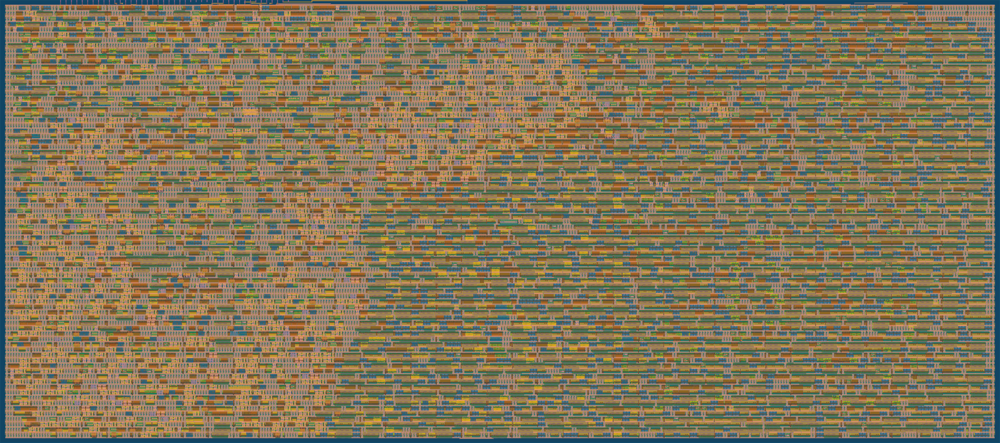

   

# CNN Conv Accelerator (Tiny Tapeout, sky130)

A streaming 3x3 convolution accelerator from CNNAccelTeam9, packaged for
[Tiny Tapeout](https://tinytapeout.com): one CNN layer on an 8x8 INT8
image with 2 filters computed in parallel, 6x6x2 INT20 output.

**Team:** Nitya Shah, Kush Shah, Kiran Karthik, Toprak Celikel

Built in the **Basics of ASICs (bASICs)** course at the
[MIT Beaver Works Summer Institute (BWSI)]([https://bwsi.mit.edu/bwsi-programs-2/basics-of-asics/]).
Thank you to the BWSI instructors and staff, and to the Tiny Tapeout team.

- How it works, pinout and how to drive it: [docs/info.md](docs/info.md)
- Top module: `tt_um_nityashah1811_cnn_accel` ([src/project.v](src/project.v))
- **1x2 tiles, 40 MHz, 65% utilisation, timing met in every corner**
- Final layout and signoff reports: [gds/](gds/)
- The 4-filter 2x2 version is tag
  [`v1.0-2x2`](https://github.com/nityashah1811/tt-cnn-accel/tree/v1.0-2x2)



## Architecture

```
 weights (18 B) ──► 2 x 72-bit free-running weight loops ──► 1 bit/clk ─┐
                                                                         ▼
 pixels (64 B) ──► 19-pixel line buffer ──► 9 fixed window taps ──► 2 bit-serial MACs ──► 6 result bytes
                                                                    (one per filter)
```

- **Line buffer.** The host streams pixels in. The chip keeps the newest
  19 (two rows plus three); when a pixel completes a 3x3 window, the window
  is at fixed buffer taps. No 64-way memory lookup.
- **Free-running weight loops.** Each filter's 9 weights sit in a 72-bit
  loop that shifts every clock with no hold logic. A 0..71 phase counter
  names the bit at the head; new weight bytes are slipped in as their slots
  pass, and each output position is computed during phases 0..71.
- **Bit-serial MACs.** Each MAC adds the pixel shifted by one weight bit per
  clock (sign bit subtracts): an adder instead of an 8x8 multiplier. 72
  clocks per output position plus up to 72 waiting for phase 0 (at most
  3.6 µs at 40 MHz), 2 filters at once.
- **No output memory.** The 2 sums wait in the accumulators until the host
  reads them.
- Only flip-flops: no latches, no memories, no clock gating.

## Results

From the Tiny Tapeout GDS action for commit `1015472`
([run 41227675903](https://github.com/nityashah1811/tt-cnn-accel/actions/runs/41227675903)),
LibreLane on sky130A with `sky130_fd_sc_hd` cells. Files in [gds/](gds/):
`tt_um_nityashah1811_cnn_accel.gds` (final layout), `.lef`, `metrics.csv`,
`synthesis-stats.txt`, `precheck_results.md`, `layout.png`.

**Size and power**

| | |
|---|---|
| Tiles | 1x2 |
| Die | 161.00 x 225.76 µm (36,347 µm²) |
| Cells after synthesis | 1,140 (15,716 µm²), including 399 flip-flops |
| Standard cells after place and route | 2,194 (22,404 µm²) |
| Utilisation | 65.4% |
| Wire length | 35,604 µm |
| Power (typical corner) | 1.8 mW |

**Timing at 40 MHz (25 ns clock)**, worst over min/nom/max parasitics:

| Corner | Setup slack | Hold slack |
|---|---|---|
| Typical (tt, 25 °C, 1.80 V) | +16.60 ns | +0.30 ns |
| Slow (ss, 100 °C, 1.60 V) | +11.15 ns | +0.86 ns |
| Fast (ff, −40 °C, 1.95 V) | +17.68 ns | +0.11 ns |

0 setup and 0 hold violations.

**Signoff**

| Check | Result |
|---|---|
| Tiny Tapeout precheck | 15/15 pass |
| Routing DRC errors | 0 |
| LVS errors | 0 |
| Antenna violations | 0 |
| cocotb tests on RTL | 7/7 pass |
| cocotb tests on the routed gate-level netlist | 7/7 pass |
| Max slew / fanout / cap warnings | 241 / 28 / 0 (warnings only, not checked by precheck) |

## Verification

| What | Result |
|---|---|
| cocotb (`test/test.py`), RTL and gate-level in CI | 7 tests: identity, extremes (largest +/− sums, all −1, alternating), 4 random images, START with kept weights and mid-image restart, protocol abuse (extra bytes, writes and reads while busy, stray RD), reset mid-image, fastest legal strobes |
| Gate-level stress (synthesized netlist, 64 parallel lanes, random power-up state) | 14 test groups incl. weights written at random phases of the weight loops, 896 full convolutions, every result checked |
| Mutation testing | 17 deliberately planted bugs (wrong tap, sign step, rotation direction, weight injected one slot late, compute not aligned to phase 0, weights sent to the wrong filter, missing +1, short readout, ...): 17/17 caught |
| VM testbench (`vm/tb_vm.v`, plain iverilog) | 8 tests, self-checking |

## How it got to 1x2

| Version | Filters | Synthesized area | Tiles | Slow-corner setup slack |
|---|---|---|---|---|
| Original RTL with byte-wide wrapper, 4 array multipliers, 50 MHz | 4 | 60,771 µm² | 3x2 | −2.21 ns |
| Pixel and weights registered before the multipliers, 40 MHz | 4 | 62,431 µm² | 3x2 | +10.09 ns |
| Streaming: line buffer, rotating weights, bit-serial MACs (`v1.0-2x2`) | 4 | 26,159 µm² | 2x2 | +11.02 ns |
| **2 filters, free-running weight loops** | **2** | **15,716 µm²** | **1x2** | **+11.15 ns** |

## Source

| File | What it is |
|------|------------|
| `src/project.v`   | Tiny Tapeout wrapper: input synchronisers, strobe edge detection, pin mapping |
| `src/cnn9_core.v` | phase counter, weight loops, line buffer, window taps, FSM, result readout |
| `src/cnn9_mac.v`  | bit-serial signed multiply-accumulate |
| `test/test.py`    | cocotb tests (RTL and gate-level) |
| `test/cnn_model.py` | golden model of the convolution |
| `vm/`             | OpenLane config and iverilog testbench for bASICs VM |
| `gds/`            | final layout and signoff reports |

All module names start with `cnn9_` because module names must be unique
across the whole Tiny Tapeout chip.

## Running the tests

On Linux with `iverilog` installed:

```sh
pip install -r test/requirements.txt
cd test
make -B
```

Gate-level test (after hardening, copy the netlist to
`test/gate_level_netlist.v` first):

```sh
make -B GATES=yes
```

Without pip (for example on bASICs VM), see [vm/README.md](vm/README.md).

## Hardening

The GitHub Actions in this repo harden the design on every push. To run
OpenLane locally, see [vm/README.md](vm/README.md) or
<https://tinytapeout.com/guides/local-hardening/>.
